# Yahini

**From keyword research to a published draft, in one workspace.** Yahini reads your site and your competitors, finds the searches worth writing about, plans each piece and writes it in your brand's voice. Then it tracks how the pages perform in Google Search Console.

[Website](https://yahini.io) · [Documentation](https://documentation.yahini.io)

<picture>
  <source media="(prefers-color-scheme: dark)" srcset="docs/src/assets/screenshots/home-dark.png">
  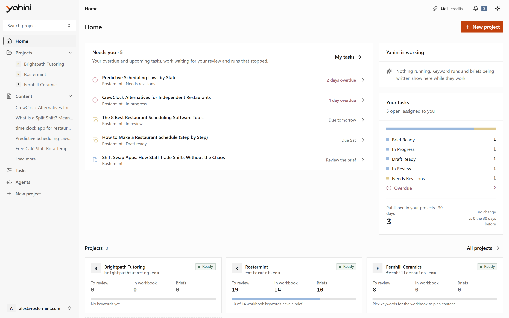
</picture>

> Screenshots come from a real Yahini account, with other sites' domains renamed. Light and dark themes follow your GitHub appearance.

## Projects at a glance

Each project has a dashboard: Search Console clicks, impressions, CTR and position against the previous period, top movers, and the tasks coming up next.

<picture>
  <source media="(prefers-color-scheme: dark)" srcset="docs/src/assets/screenshots/dashboard-dark.png">
  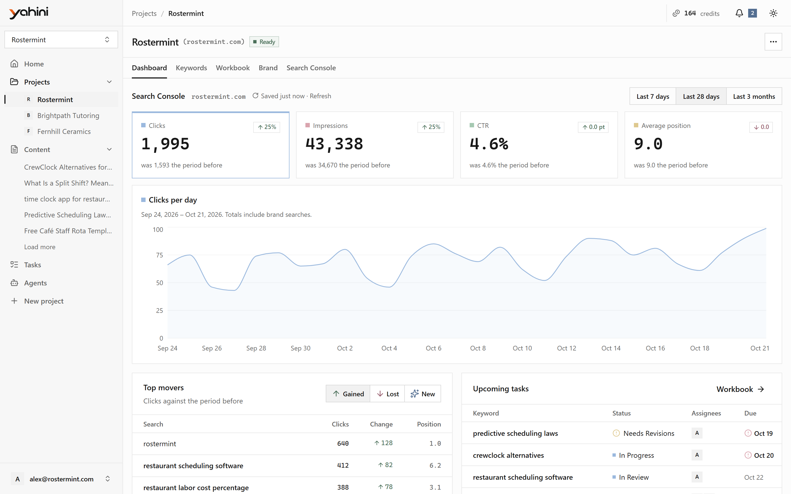
</picture>

## Keyword research

Keyword research finds, scores and groups the searches your site can win. You get volume, difficulty, priority and funnel stage for each one, with related variants grouped under it. Filter, sort, hide what doesn't fit, or import and export CSV.

<picture>
  <source media="(prefers-color-scheme: dark)" srcset="docs/src/assets/screenshots/keywords-dark.png">
  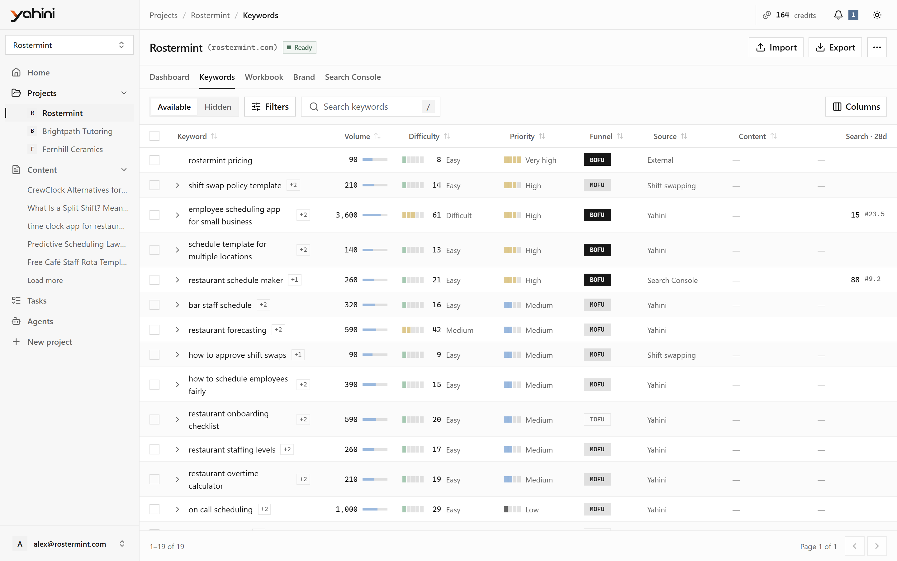
</picture>

## The workbook

The keywords you pick become tasks. Follow them in a table, on a board or on a calendar, with status, assignees and due dates.

<picture>
  <source media="(prefers-color-scheme: dark)" srcset="docs/src/assets/screenshots/workbook-dark.png">
  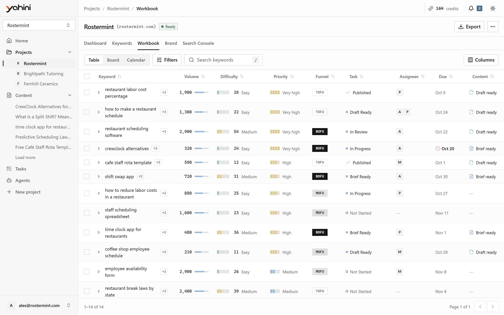
</picture>

Every task across your projects is in one place:

<picture>
  <source media="(prefers-color-scheme: dark)" srcset="docs/src/assets/screenshots/tasks-dark.png">
  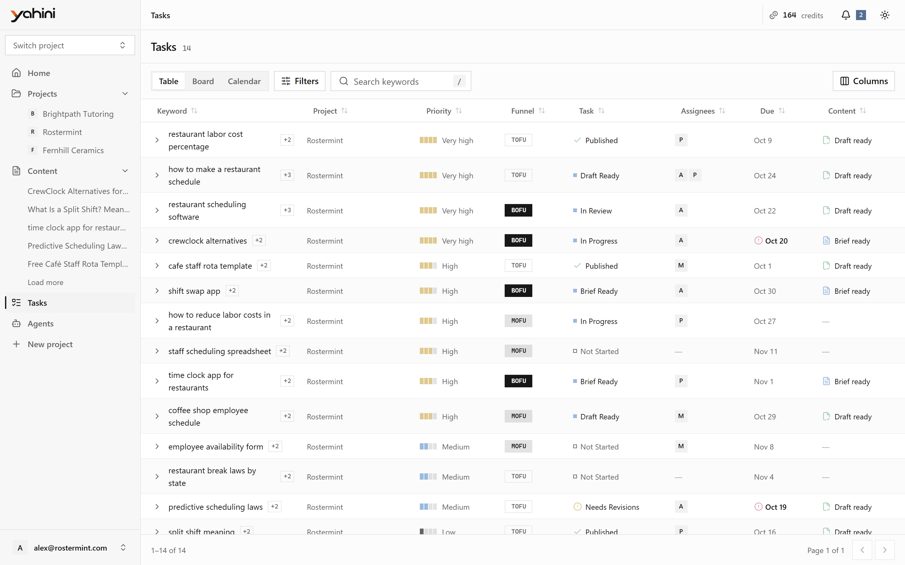
</picture>

## Brand intelligence

Brand intelligence learns your product, features, benefits, audience, pain points and use cases from your site, so every brief and draft is written for your business. Edit any of it yourself.

<picture>
  <source media="(prefers-color-scheme: dark)" srcset="docs/src/assets/screenshots/brand-dark.png">
  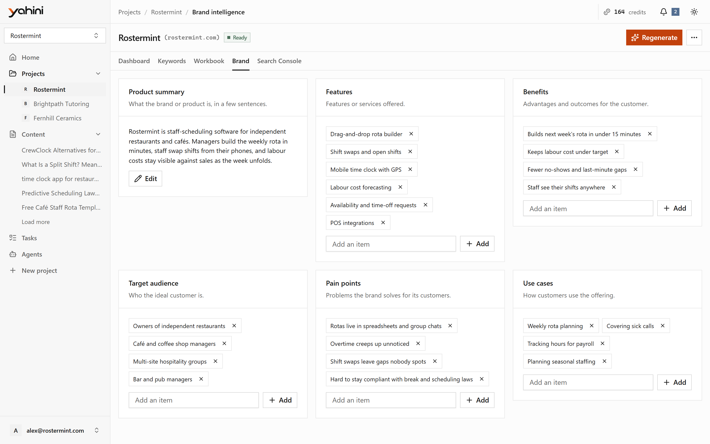
</picture>

## Briefs and drafts

A brief plans the piece: its angle, structure and what to cover. The draft is written from the brief. Edit both in a rich-text editor, set the meta title and description, and export to Word.

<picture>
  <source media="(prefers-color-scheme: dark)" srcset="docs/src/assets/screenshots/brief-dark.png">
  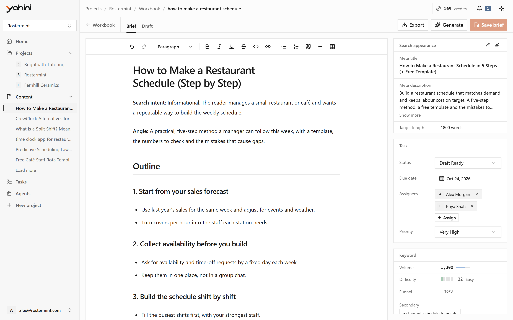
</picture>

<picture>
  <source media="(prefers-color-scheme: dark)" srcset="docs/src/assets/screenshots/my-briefs-dark.png">
  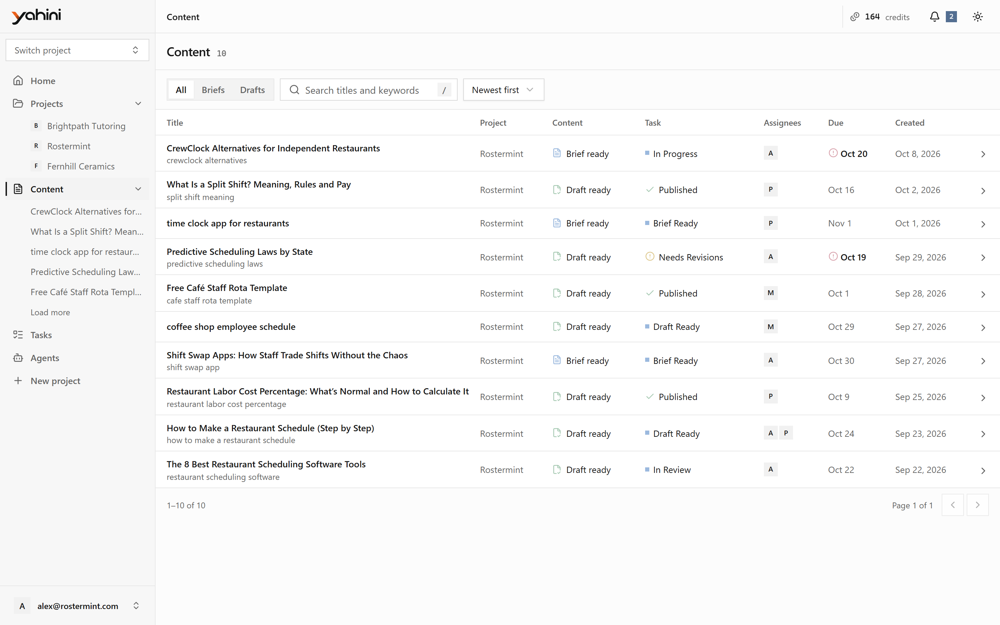
</picture>

## Search Console

Connect Google Search Console to see the queries each page ranks for, which ones are already in your project, and to add the searches your site appears for with **Find my keywords**.

<picture>
  <source media="(prefers-color-scheme: dark)" srcset="docs/src/assets/screenshots/search-console-dark.png">
  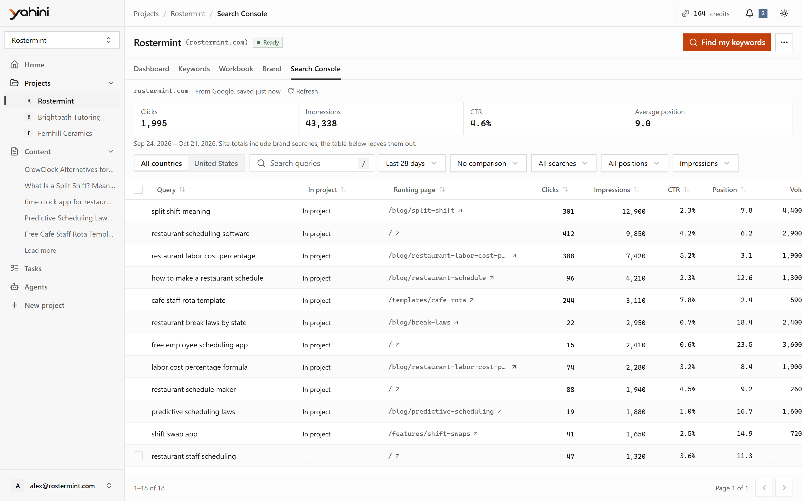
</picture>

## Agents and credits

Each piece of work is an agent with a clear credit cost. Failed work is refunded.

<picture>
  <source media="(prefers-color-scheme: dark)" srcset="docs/src/assets/screenshots/agents-dark.png">
  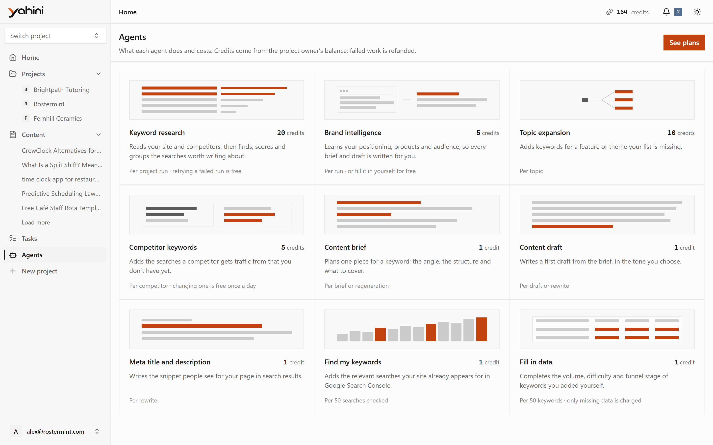
</picture>

<picture>
  <source media="(prefers-color-scheme: dark)" srcset="docs/src/assets/screenshots/billing-dark.png">
  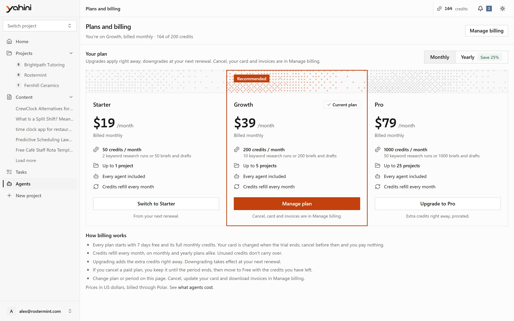
</picture>

## On mobile

  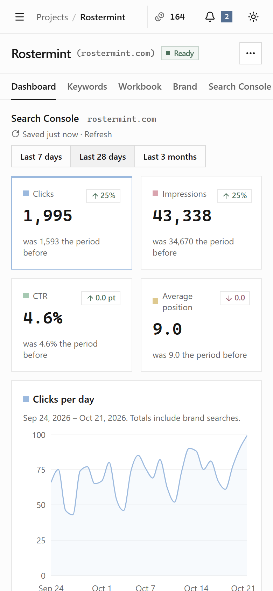
  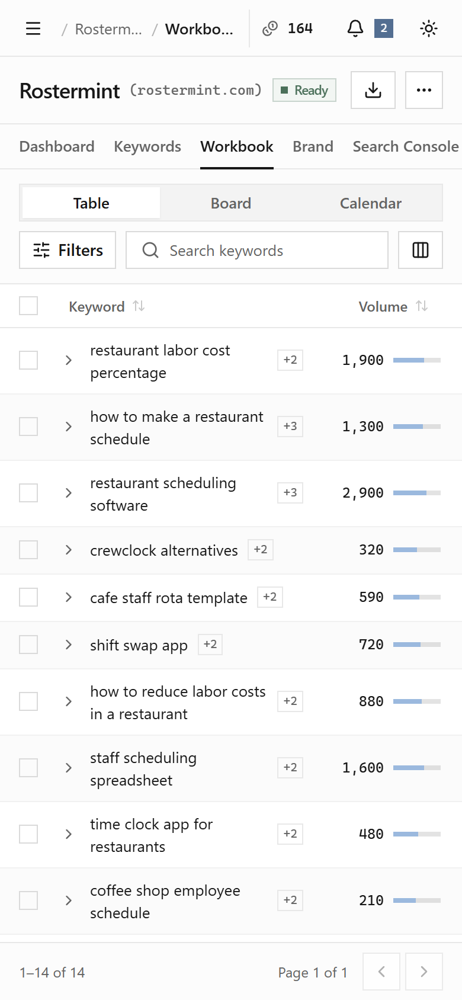
  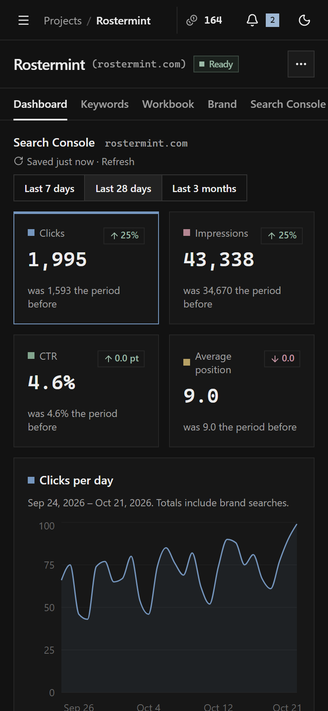

## More

- Share projects with your team, and assign tasks to them.
- Use your projects from AI assistants through the Yahini MCP server.
- Light, dark or system theme.

The [documentation](https://documentation.yahini.io) explains every feature step by step. Its source is in [`docs/`](docs/).

---

© Yahini. All rights reserved.
